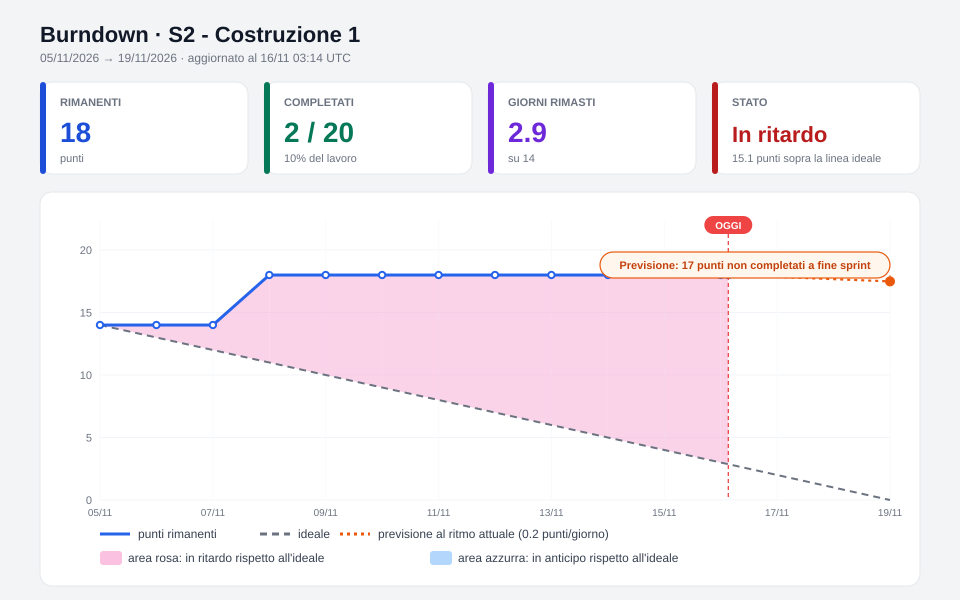

# PICUS

Progetto di Software Architecture Design del gruppo **Pinguini alla Fragola**,
a.a. 2026/27, Università degli Studi di Napoli Federico II.

**Docente:** Prof. Anna Rita Fasolino.

PICUS supporta il Banco nel coordinamento delle Organizzazioni Partner
Territoriali, delle richieste di misure di accompagnamento e del monitoraggio.
Il gruppo sta definendo i processi as-is e to-be nell'iterazione preparatoria.

## Team

| Nome | GitHub | Scrum Role |
|------|--------|------------|
| Antonio Caprio *(Referente)* | [@CapHello](https://github.com/CapHello) | Product Owner |
| Gianluca Cinquegrana | [@giallo04](https://github.com/giallo04) | Developer |
| Salvatore Di Costanzo | [@salvatoredc04](https://github.com/salvatoredc04) | Scrum Master |
| Alessandro Fontana | [@AlessandroFontana04](https://github.com/AlessandroFontana04) | Developer |
| Christian Formicola | [@Darkessence97](https://github.com/Darkessence97) | Developer |
| Manuel Fornataro 🐧 | [@man-for04](https://github.com/man-for04) | Developer |
| Giovanni Fragola | [@giob22](https://github.com/giob22) | Developer |
| Roberta Giovengo 🍓 | [@bobby273](https://github.com/bobby273) | Developer |

## Documentazione

- [Requisiti e modelli di analisi](docs/requirements/README.md)
- [Scenari di qualità](docs/quality-scenarios/README.md)
- [Architettura](docs/architecture/README.md)
- [Registro delle decisioni](docs/adr/README.md)
- [Review delle iterazioni](docs/reviews/README.md)
- [Esportazione PDF del documento](docs/Documentazione_SAD_2026.pdf)
- [Regole di contribuzione](.github/CONTRIBUTING.md)


## Prerequisiti

- Java **25 LTS**.
- Maven **3.9 o successivo**; il Maven Wrapper permette di usare la versione
  fissata per il progetto senza installare Maven separatamente.
- Spring Boot **4.1.2**, fissato nel POM come base della linea **4.1+**.
- JUnit Jupiter **5 o successivo**, nella versione gestita da Spring Boot.

## Build e test

```bash
mvn verify
```

Con il Maven Wrapper:

```bash
bash ./mvnw verify
```

In PowerShell:

```powershell
.\mvnw.cmd verify
```

## Avvio locale con Docker Compose

Da un clone pulito, copia `.env.example` in `.env` e imposta le due password
locali di prova (vedi [Configurazione `.env`](#configurazione-env)). Esegui
dalla radice del progetto:

```bash
docker compose up --build
```

`picus-webapp` risponde su `http://localhost:8080` e usa PostgreSQL nel
servizio `picus-db`. Flyway crea lo schema e carica le 12 misure
dell’Appendice A, i comuni e le adiacenze di esempio. Il profilo `demo`
inserisce quattro account sintetici attivi:

- `banco@picus.test`
- `opt-a@picus.test`
- `opt-b@picus.test`
- `operatore@picus.test`

`PICUS_DEMO_PASSWORD` è la password iniziale degli account demo, salvata
come hash. Il login PICUS (#25) è disponibile su `http://localhost:8080/login`.
Il volume `picus-dati` conserva le tabelle e i dati fra gli avvii.

Per verificare la predisposizione, esegui `./mvnw clean package`
(`./mvnw.cmd clean package` in PowerShell) e controlla l’avvio dei servizi
con `docker compose ps`.

### Aggiornare una demo avviata con la V5 del login

Se il database locale ha già applicato `V5__blocco_accessi.sql`, ferma la
demo dal progetto Compose usato in precedenza e avvia la versione aggiornata
con un nuovo nome di progetto.

```bash
docker compose down
docker compose -p picus-demo-v2 up --build
```

Il nuovo progetto usa il volume separato `picus-demo-v2_picus-dati`.
Usa `-p picus-demo-v2` anche con i successivi comandi `ps`, `logs` e `down`.
Se la demo precedente usava un nome personalizzato, passalo con `-p` al
primo comando.

### Configurazione `.env`

Il file `.env` sta nella radice del progetto, accanto a `docker-compose.yml`, e
non va versionato. `.env.example` ne elenca le variabili, entrambe obbligatorie:
`docker compose` si ferma con un errore se una è vuota.

| Variabile | Uso |
|-----------|-----|
| `PICUS_DB_PASSWORD` | Password dell’utente `picus` di PostgreSQL, usata da `picus-db` e da `picus-webapp`. |
| `PICUS_DEMO_PASSWORD` | Password iniziale dei quattro account demo, salvata come hash BCrypt. Vale al massimo 72 byte UTF-8. |

## Avvio dello skeleton senza database

Lo *skeleton* avvia l’applicazione con le utenze in memoria: login, area per
ruolo e logout funzionano senza PostgreSQL e senza Docker. Dalla radice del
progetto:

```bash
mvn spring-boot:run -Dspring-boot.run.profiles=skeleton
```

Con il Maven Wrapper: `bash ./mvnw spring-boot:run -Dspring-boot.run.profiles=skeleton`
(`.\mvnw.cmd spring-boot:run "-Dspring-boot.run.profiles=skeleton"` in PowerShell).

L’app risponde su `http://localhost:8080/login`. Gli account attivi sono
`banco@picus.test`, `opt@picus.test` e `operatore@picus.test`; la password è
`picus-demo`, modificabile con la proprietà `picus.skeleton.password`. Il
cookie di sessione non è `Secure`, per l’uso locale in http. Il profilo è solo
per sviluppo e test.

## Convenzione per viste e risorse web

I percorsi sono globali e valgono per tutti i moduli:

- `src/main/resources/web/dynamic/` contiene i template Thymeleaf. Ogni modulo
  usa la propria sottocartella, ad esempio `web/dynamic/utenze/login.html`,
  che il controller restituisce come vista `utenze/login`.
- `src/main/resources/web/static/` contiene le risorse statiche, servite dalla
  radice: `web/static/css/picus.css` risponde su `/css/picus.css`; analoghi
  `/js/` e `/img/`.

La Content-Security-Policy imposta `default-src 'self'`: CSS, script, font e
immagini vanno serviti da `web/static/`, non da host esterni. Per questo
l’interfaccia usa i font di sistema.

### Risposte di accesso negato

Una richiesta è di **API** se il percorso è sotto `/api/`, se è XHR
(`X-Requested-With: XMLHttpRequest`) o se `Accept` preferisce JSON
(`application/json` o un tipo `+json` con qualità maggiore di zero e maggiore
di quella di HTML). Tutto il resto è una **pagina HTML**.

| Caso | Pagina HTML | API |
|------|-------------|-----|
| Senza sessione | `302` verso `/login` | `401`, senza redirect |
| `POST` senza sessione e senza token CSRF | `403` | `401` |
| Sessione revocata (qualunque area o metodo alla prima richiesta) | `302` verso `/login?error`, sessione chiusa | `401`, sessione chiusa |
| Sessione valida, ruolo non abilitato | `403` | `403` |
| Sessione valida, `POST` senza token CSRF | `403` | `403` |

Il controllo della sessione avviene prima di CSRF e dei permessi di ruolo.
Le responsabilità sono in `shared/SecurityConfig` e `shared/RichiestaApi`.

## 🏭 Project management

Il team adotta **Scrum**. User Story, attività e stato di avanzamento
sono tracciati su GitHub Projects:

- [Backlog Progetto-SAD](https://github.com/orgs/Pinguini-alla-Fragola/projects/2)

<!-- BURNDOWN:START — grafico dello sprint in corso, aggiornato ogni sera dal workflow "burndown"; non modificare il link -->
## 📉 Avanzamento dello sprint



*Aggiornato ogni sera. Gli sprint precedenti sono nel branch [`burndown-data`](https://github.com/Pinguini-alla-Fragola/Progetto-SAD/tree/burndown-data).*

Il calcolo esclude le Pull Request e le issue di tipo nativo `Epic`, anche
quando appartengono all'iterazione. Gli altri item mantengono la stima del
Project: `Estimate`, altrimenti `Size`, altrimenti 1 punto.
<!-- BURNDOWN:END -->
