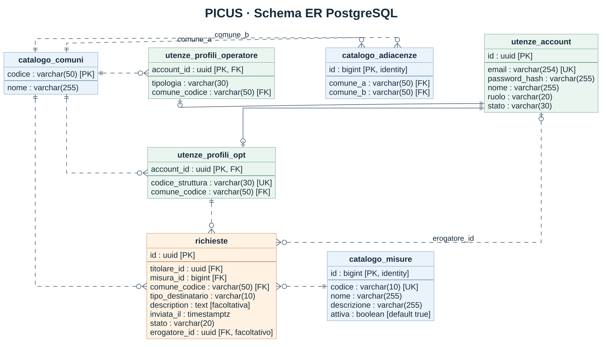

# Architettura

## Diagrammi

| Diagramma | Anteprima | Descrizione |
| --- | --- | --- |
| System Context |  | Confini di PICUS e soggetti che interagiscono con il sistema. |
| Flusso dell’architettura MVC |  | Percorso di una richiesta dal browser alla pagina di risposta. |
| Module & Package View |  | Organizzazione dei moduli e dei package Java. |
| Deployment & Container View |  | Applicazione e database nell’ambiente Docker Compose. |
| CC-01 · Struttura runtime |  | Collegamenti tra browser, applicazione, database e servizio email. |
| CC-02 · Ingresso web e accesso ai dati |  | Passaggio delle richieste dal web ai moduli e accesso a PostgreSQL. |
| CC-03 · Collaborazioni tra componenti |  | Interazioni tra i cinque componenti applicativi. |
| Walking skeleton 1 · Accesso e invio |  | Accesso della OPT e invio di una richiesta. |
| Walking skeleton 2 · Presa in carico e contatto |  | Presa in carico, ricerca e contatto degli erogatori. |
| Walking skeleton 3 · Risposta e assegnazione |  | Risposta dell’erogatore e assegnazione della richiesta. |
| Walking skeleton 4 · Conferma o rifiuto |  | Conferma dell’appuntamento o rifiuto della richiesta. |
| Stati della richiesta |  | Stati della richiesta e passaggi da uno stato all’altro. |
| Schema ER PostgreSQL |  | Tabelle e relazioni della persistenza iniziale. |

### Aggiornare le anteprime SVG

Installa Python 3 con Pillow e i renderer per i formati che modifichi.
Graphviz (`dot`) e Mermaid CLI (`mmdc`) devono essere nel `PATH`.
Per PlantUML, usa Java 25 e indica il percorso del JAR. Le versioni sono
riportate nel [workflow dei diagrammi](../../.github/workflows/diagrams.yml).

```console
python scripts/verifica_diagrammi.py --aggiorna --plantuml-jar "/percorso/plantuml.jar"
```

Il comando rigenera gli SVG delle sorgenti nuove o modificate rispetto
all'antenato comune con `origin/main`. Senza quel riferimento confronta i file
di lavoro con `HEAD`. Usa `--base` per scegliere un altro commit e ometti
`--plantuml-jar` se hai modificato solo diagrammi Mermaid o DOT.

## Stati della richiesta

Il diagramma segue il ciclo definito in [ADR-002](../adr/ADR-002-ciclo-di-vita-richiesta.md).
Sulle frecce, le parentesi prima del comando indicano chi può eseguirlo e
a quali condizioni. Le parentesi dopo il comando indicano il risultato.

| Da | Comando | Chi lo esegue e a quali condizioni | Esito |
| --- | --- | --- | --- |
| Avvio | `invia()` | OPT titolare, con un invio valido | Creata, in coda |
| Creata | `prendiInCarico()` | Banco | Presa in carico, ricerca aperta |
| Presa in carico | `assegnaErogatore()` | Banco, dopo una risposta positiva | In programmazione |
| In programmazione | `confermaAccordo()` | Banco, con accordo completo | Confermata, dettagli immutabili |
| Presa in carico | `rifiutaRichiesta()` | Banco, con esito negativo per ogni opzione, remoto incluso se compatibile, e nessun contatto in attesa | Rifiutata, nessun erogatore disponibile |
| In programmazione | `rifiutaRichiesta()` | Banco, con accordo impraticabile e nessun contatto in attesa | Rifiutata, nessun erogatore disponibile |
| Creata, Presa in carico, In programmazione, Confermata, Rifiutata | `annullaRichiesta()` | Banco, OPT titolare o erogatore assegnato. Il motivo è facoltativo solo da Creata | Annullata, dettagli conservati |

L’annullamento è previsto dalla [#54](https://github.com/Pinguini-alla-Fragola/Progetto-SAD/issues/54).
La [matrice](../requirements/regole-funzionali.md#matrice-di-annullamento)
riporta le autorizzazioni per ciascun ruolo.

Per rigenerare PNG e SVG dal [sorgente DOT](diagrams/stati-richiesta/PICUS-Stati-Richiesta.dot),
eseguire dalla radice del progetto con Graphviz nel `PATH`.

```powershell
$stati = 'docs/architecture/diagrams/stati-richiesta/PICUS-Stati-Richiesta'
dot -Tpng "$stati.dot" -o "$stati.png"
dot -Tsvg -Gdpi=72 "$stati.dot" -o "$stati.svg"
$svg = (Get-Content -LiteralPath "$stati.svg" -Raw -Encoding UTF8) -replace '<svg width="[\d.]+pt" height="[\d.]+pt"', '<svg width="100%"'
[IO.File]::WriteAllText((Resolve-Path -LiteralPath "$stati.svg").Path, $svg)
```

## Javadoc

Il [Javadoc di PICUS](https://pinguini-alla-fragola.github.io/Progetto-SAD/) documenta i package e le classi Java.
