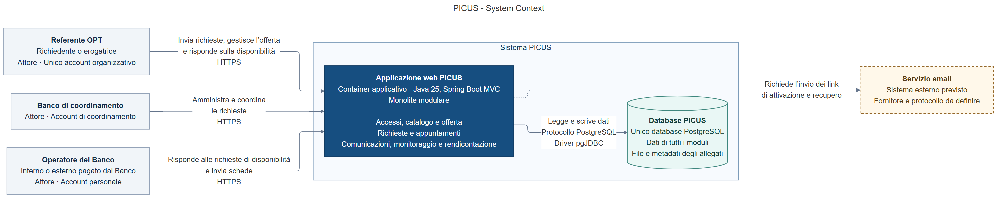
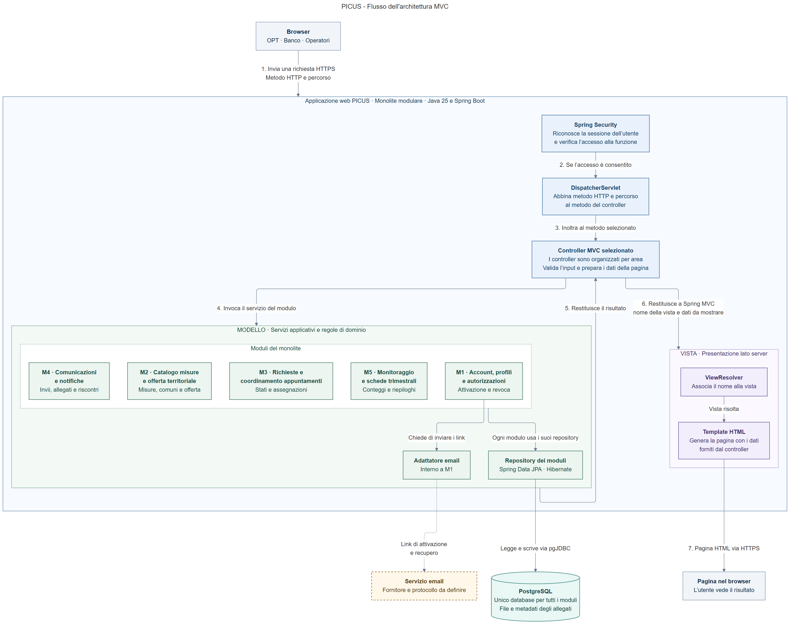
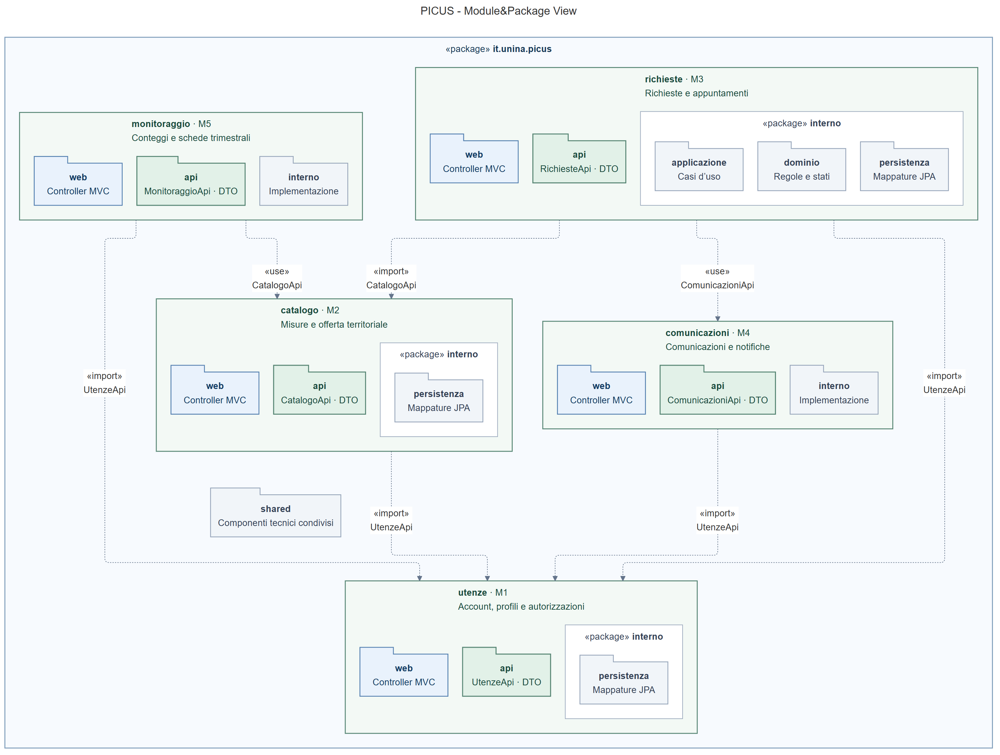
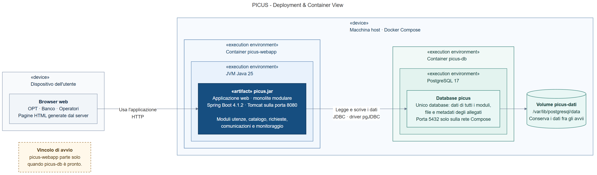
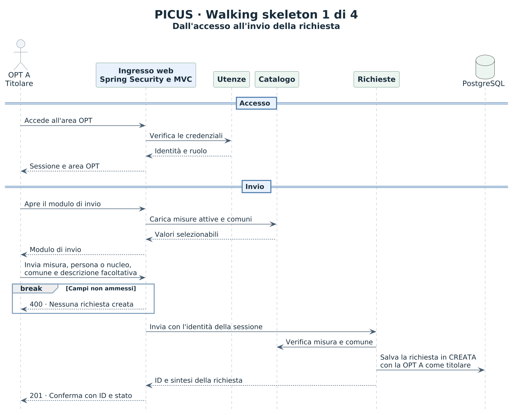
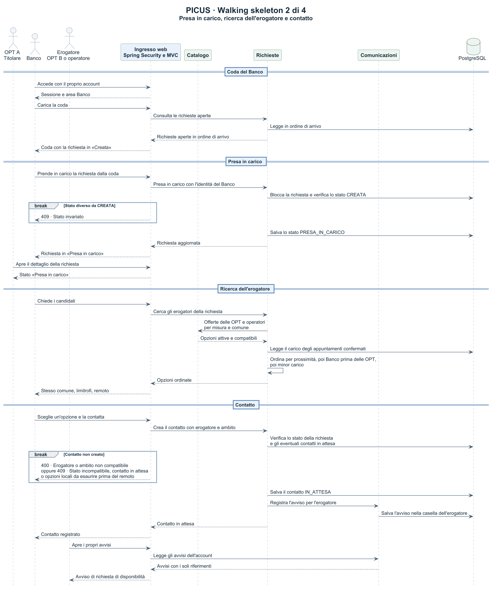
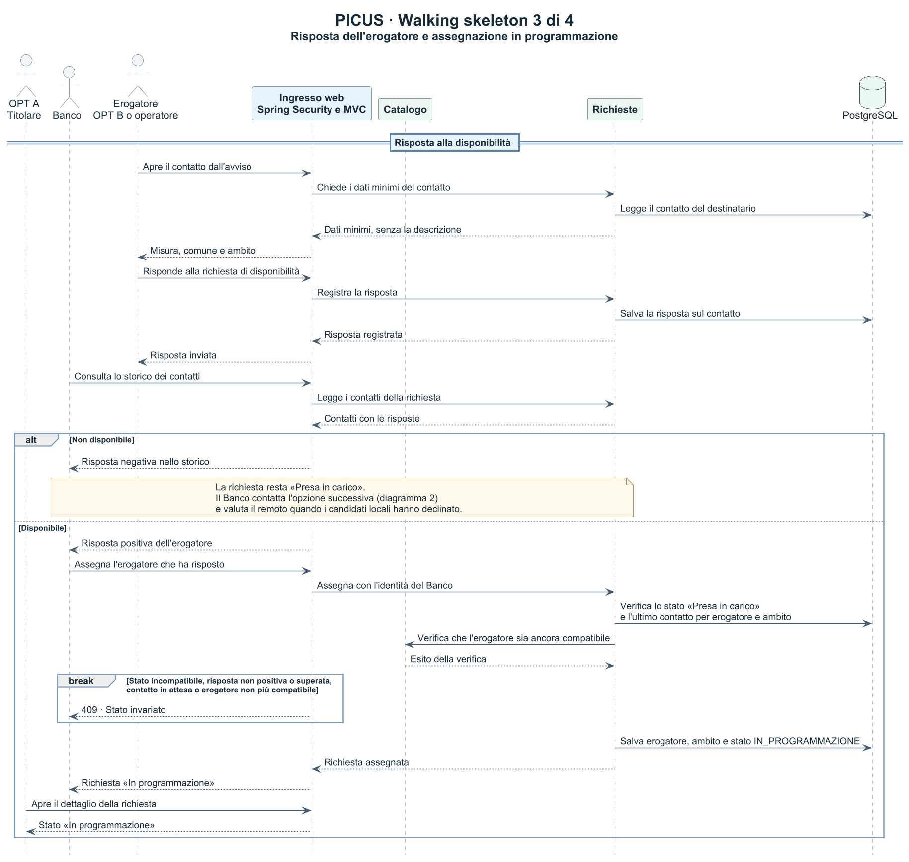
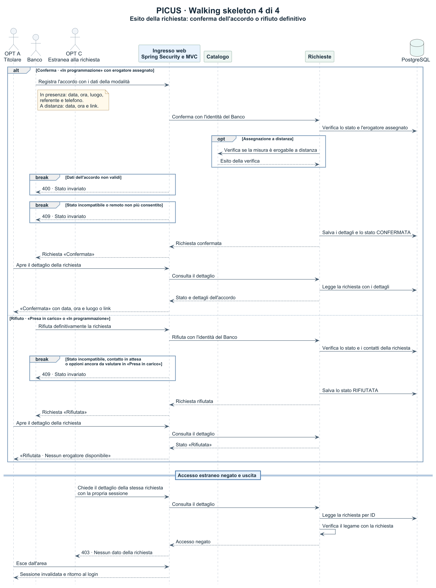
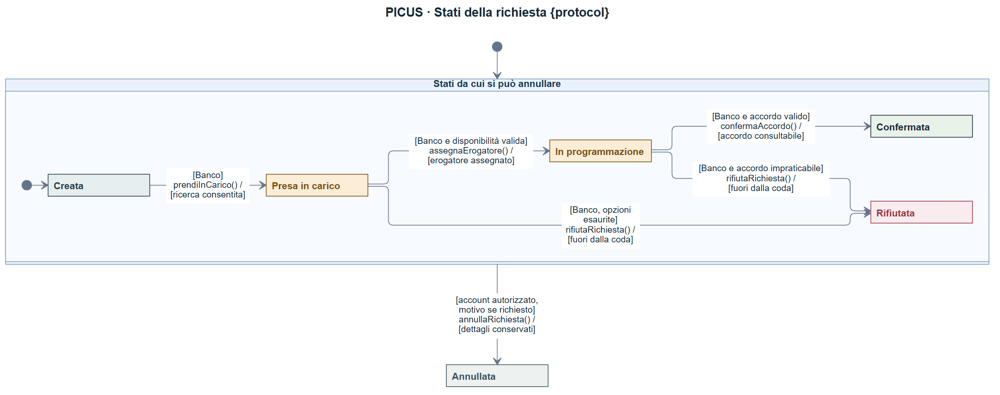
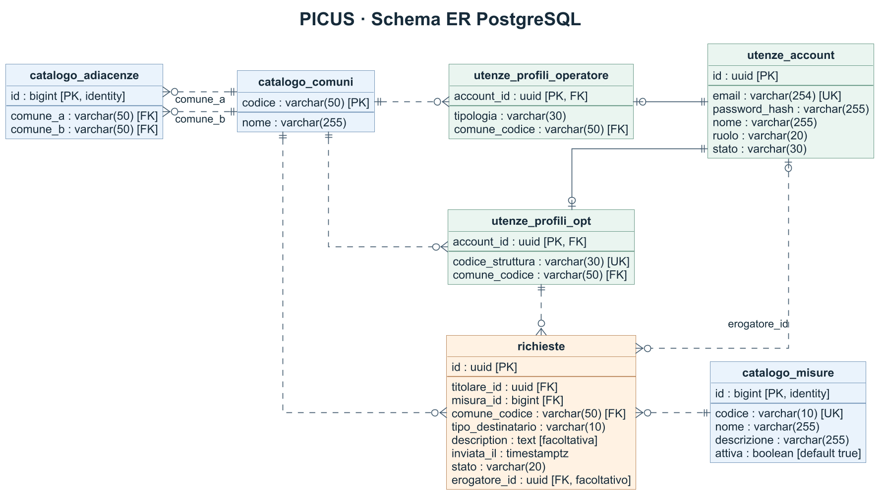

# Architettura

## Diagrammi

| Diagramma | Anteprima | Descrizione |
| --- | --- | --- |
| System Context |  | Confini di PICUS e soggetti che interagiscono con il sistema. |
| Flusso dell’architettura MVC |  | Percorso di una richiesta dal browser alla pagina di risposta. |
| Module & Package View |  | Organizzazione dei moduli e dei package Java. |
| Deployment & Container View |  | Applicazione e database nell’ambiente Docker Compose. |
| CC-01 · Struttura runtime |  | Collegamenti tra browser, applicazione, database e servizio email. |
| CC-02 · Ingresso web e accesso ai dati |  | Passaggio delle richieste dal web ai moduli e accesso a PostgreSQL. |
| CC-03 · Collaborazioni tra componenti |  | Interazioni tra i cinque componenti applicativi. |
| Walking skeleton 1 · Accesso e invio |  | Accesso della OPT e invio di una richiesta. |
| Walking skeleton 2 · Presa in carico e contatto |  | Presa in carico, ricerca e contatto degli erogatori. |
| Walking skeleton 3 · Risposta e assegnazione |  | Risposta dell’erogatore e assegnazione della richiesta. |
| Walking skeleton 4 · Conferma o rifiuto |  | Conferma dell’appuntamento o rifiuto della richiesta. |
| Stati della richiesta |  | Stati della richiesta e passaggi da uno stato all’altro. |
| Schema ER PostgreSQL |  | Tabelle e relazioni della persistenza iniziale. |

## Javadoc

Il [Javadoc di PICUS](https://pinguini-alla-fragola.github.io/Progetto-SAD/) documenta i package e le classi Java.
