# Requisiti e modelli di analisi

Qui sono raccolti i requisiti e i modelli di analisi di PICUS. I diagrammi
mostrano il contesto, i processi attuali e quelli previsti, inclusa la gestione
degli account. I documenti di riferimento sono le [regole di accesso](regole-accessi.md)
e le [regole funzionali](regole-funzionali.md). Le domande aperte sono
raccolte nel [registro dei chiarimenti](open-questions.md).

| Diagramma | Anteprima |
| --- | --- |
| Diagramma di contesto |  |
| Prima bozza del contesto | 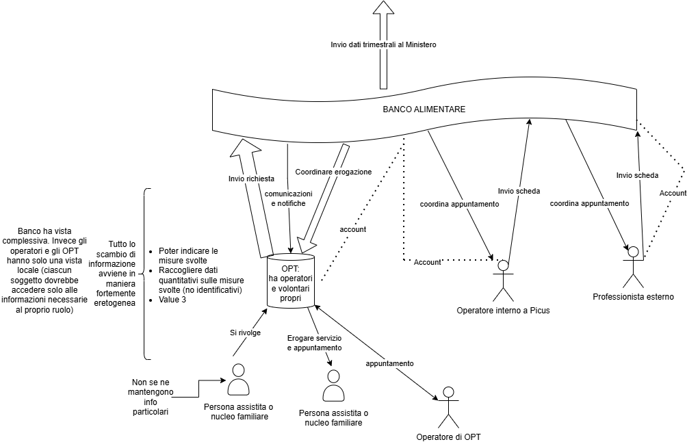 |
| ASIS-01A · Gestione delle richieste | 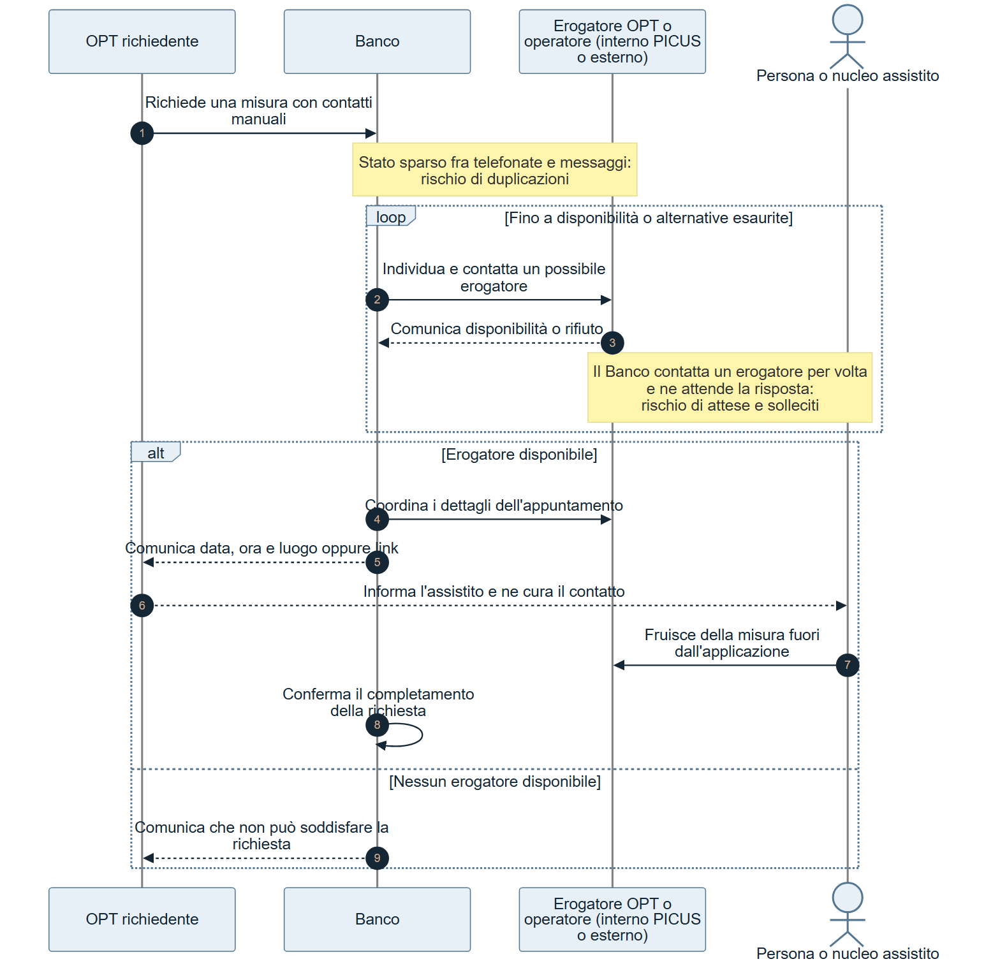 |
| ASIS-01B · Rendicontazione | 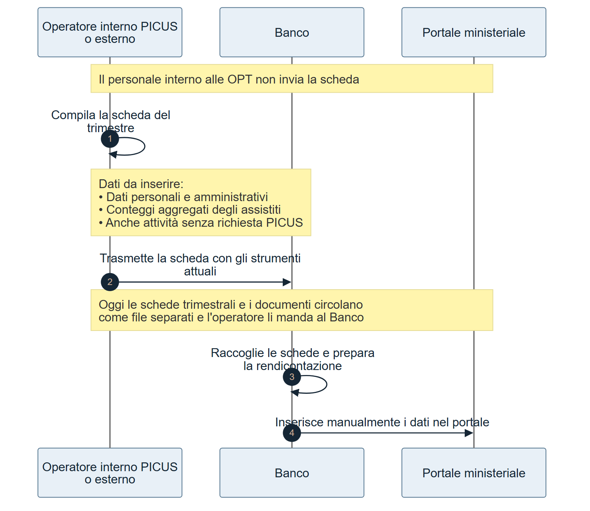 |
| TOBE-01A · Invio della richiesta e ricerca della disponibilità | 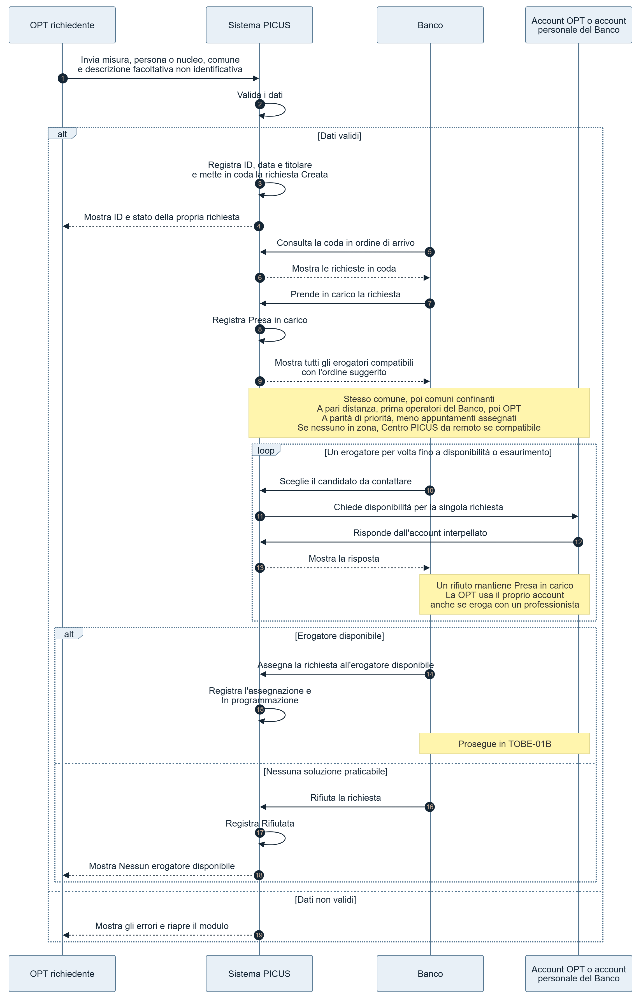 |
| TOBE-01B · Appuntamento ed esito della richiesta | 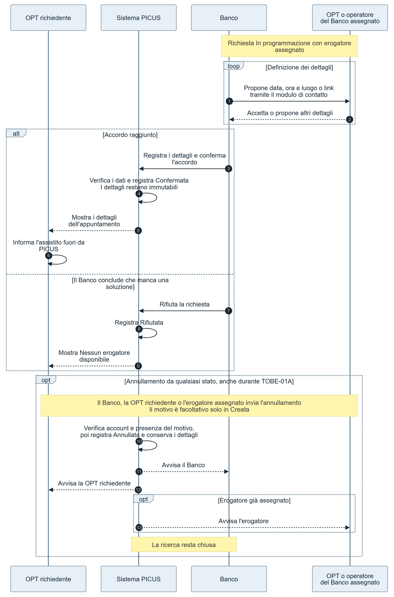 |
| TOBE-02 · Rendicontazione | 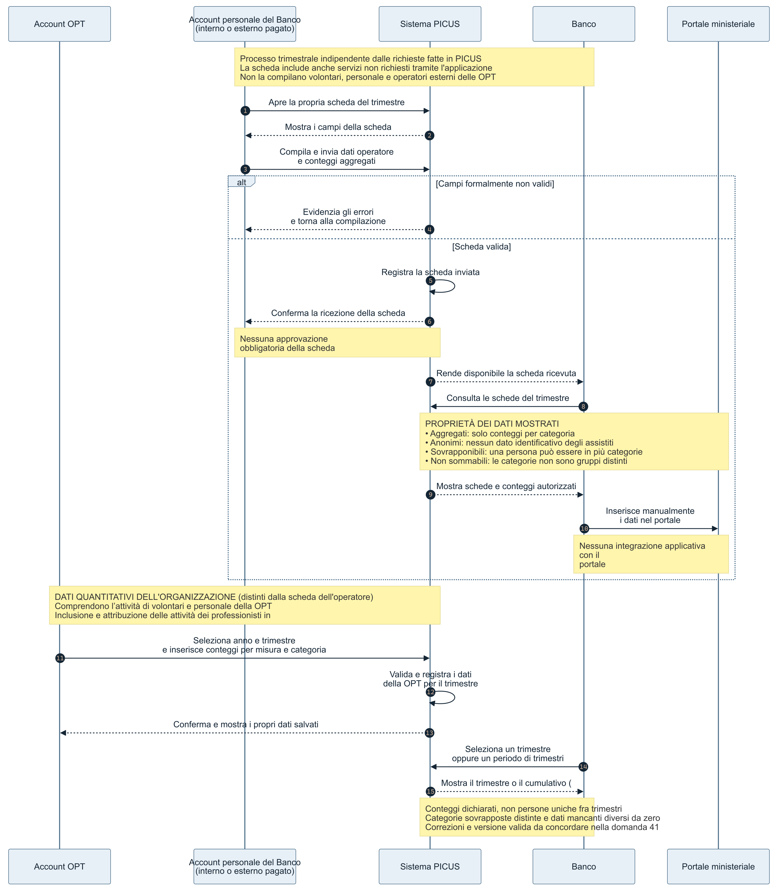 |
| IAM-24 · Caricamento delle utenze OPT da CSV | 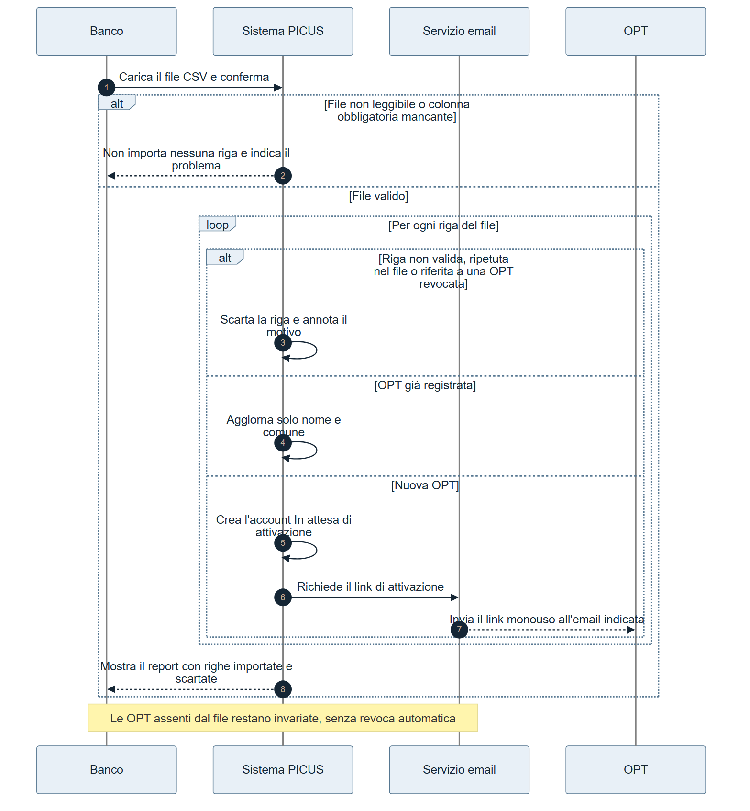 |
| IAM-25 · Accesso | 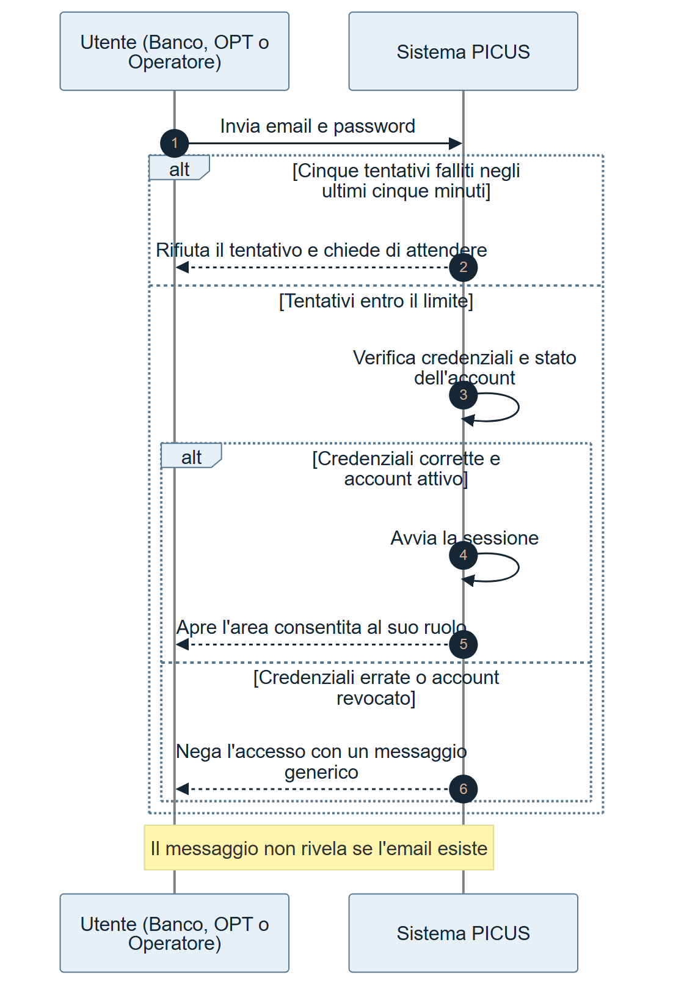 |
| IAM-26 · Revoca dell’utenza OPT | 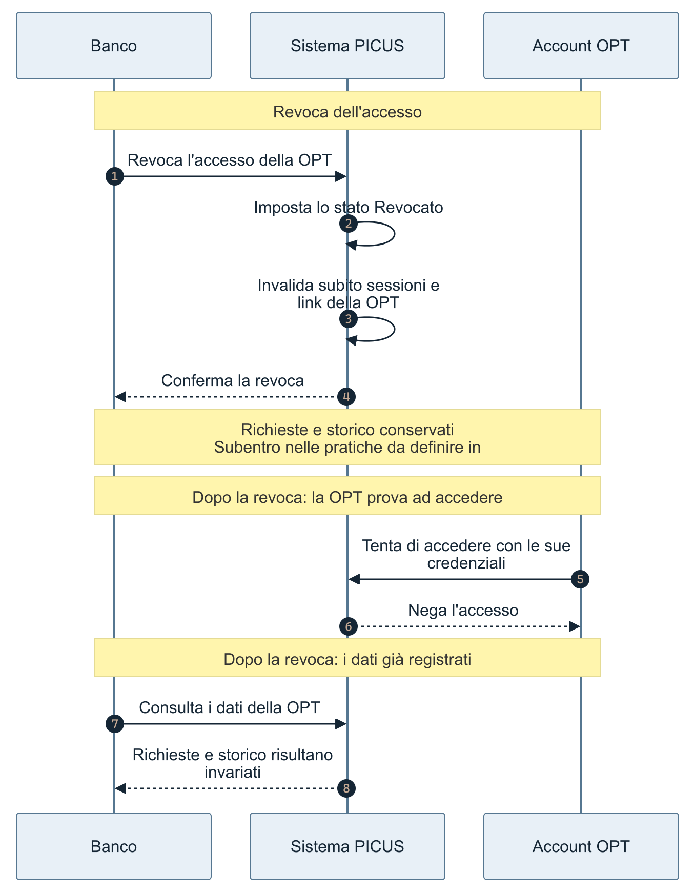 |
| IAM-27 · Creazione dell’account operatore | 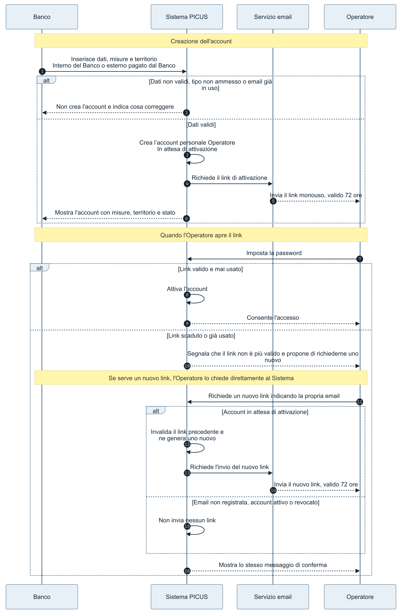 |
| IAM-28 · Accessi per ruolo | 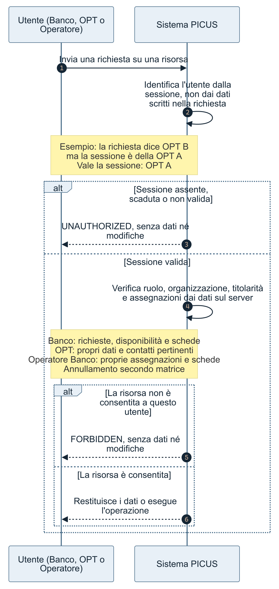 |
| IAM-30 · Revoca dell’account operatore | 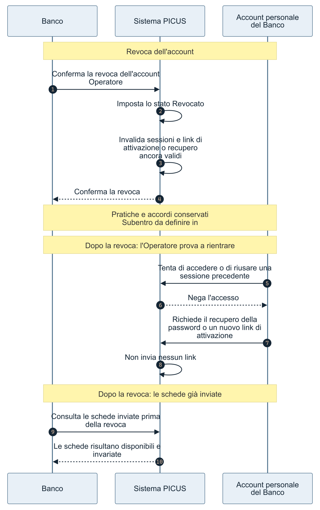 |
| IAM-33 · Recupero password | 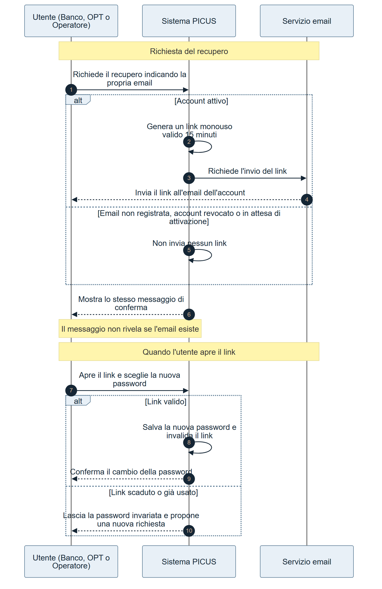 |
